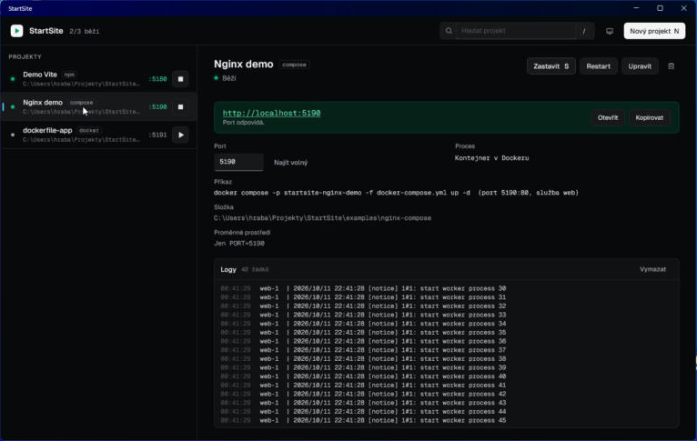

# StartSite

A local launcher for your web projects and apps. Add a project by pointing it at a folder (npm, Docker Compose, Dockerfile or a custom command), pick a port, and start it with one click. You get a `http://localhost:<port>` link and live logs. Claude controls the same projects through an MCP server, and you can drive them from the terminal with the `startsite` CLI.

The main interface is a Windows desktop app built with .NET MAUI. A web UI at http://localhost:4500 shows the same state. The UI text is in Czech.



## Requirements

- Node 20 or newer
- Windows 11 (the backend, MCP server and CLI also run on macOS and Linux)
- For the desktop app: .NET 10 SDK with the MAUI workload (`dotnet workload install maui-windows`)
- Docker Desktop, only for Docker projects

## Installation

```bash
npm install
```

```bash
npm run build
```

`npm run build` builds the shared types, backend, MCP server, CLI and web UI. The MCP server and CLI need this build to run.

## Desktop app

```bash
npm run build:desktop
```

```bash
npm run shortcut
```

`build:desktop` produces `desktop/publish/StartSite.exe`. `shortcut` creates shortcuts to it on the desktop and in the Start menu.

- On launch, the app locates the repo (from the location of the `.exe`, or the `STARTSITE_ROOT` environment variable) and starts the Node backend in the background if it is not running. If the backend dies later, the app starts it again.
- Closing the app does not stop the backend or your projects, so Claude can keep using them through MCP.
- Only one instance runs at a time. Launching it again brings the existing window to the front.
- You can pick a project folder with the system folder dialog.
- The header icon switches the theme: system, light, dark.
- Crashes are written to `%LOCALAPPDATA%\StartSite\crash.log`.

Source lives in `desktop/StartSite.Desktop/`: `Services/Backend.cs` (backend startup, HTTP API, SSE), `ViewModels/ViewModels.cs`, `Views/MainPage.xaml`.

## Running the backend and web UI

```bash
npm start
```

Open http://localhost:4500. The backend listens on `127.0.0.1` only and also serves the web UI.

To use another port, pass `--port` or set `STARTSITE_PORT`:

```bash
npm start -- --port 4700
```

The MCP server and CLI read the port only from `STARTSITE_PORT`, so set it for them too.

Development with hot reload (backend via `tsx watch`, web UI via Vite on port 4501 with an `/api` proxy):

```bash
npm run dev
```

## Registering the MCP server with Claude Code

```bash
claude mcp add startsite -- node <path-to-repo>/mcp/index.js
```

Check the connection:

```bash
claude mcp get startsite
```

It should report `Status: Connected`. If the backend is not running, the MCP server starts it in the background (output goes to `data/server.log`), so the UI and Claude always share the same state.

| Tool | What it does |
| --- | --- |
| `list_projects` | lists projects with status, port and URL |
| `get_project` | project details including environment variables |
| `add_project` | adds a folder; detects the type and script, picks a free port if none is given |
| `update_project` | changes name, port, command, env and so on |
| `remove_project` | removes the entry; files on disk stay untouched |
| `start_project` | starts the project and waits until the port responds; if the port is taken, returns who holds it and a free port |
| `stop_project` | stops the whole process tree or the containers |
| `restart_project` | stop, then start |
| `get_logs` | last N lines (`lines` parameter, default 100), without ANSI colors |
| `find_free_port` | a port not used by the system or another project |

Every tool returns the status and URL. Projects can be referenced by name or ID, case-insensitively (`Demo Vite`, `demo-vite`, `DEMO-VITE`).

## CLI

From the repo, via `npx`:

```bash
npx startsite list
```

Globally (once, from the repo root):

```bash
npm link
```

Examples:

```bash
startsite list
startsite add C:/projects/my-site --port 5180
startsite start "Demo Vite"
startsite start demo-vite --port 5181
startsite logs demo-vite -n 50
startsite logs demo-vite -f
startsite restart demo-vite
startsite stop demo-vite
startsite port 5200
```

`start` and `restart` wait until the port responds and exit with a non-zero code if it never does. When the port is taken, they print the PID and process name and suggest a free port.

## How it works

### Project types

| Folder contains | Type | Start | Stop |
| --- | --- | --- | --- |
| `package.json` | npm | `npm run <script>`, `dev` by default | `taskkill /T /F` on the whole tree |
| `compose.yaml` / `docker-compose.yml` | compose | `docker compose up -d` | `docker compose down` |
| `Dockerfile` without compose | docker | `docker build` + `docker run -d --rm -p` | `docker stop` |
| anything else | custom | your shell command, `{port}` is substituted | `taskkill /T /F` |

### Passing the port

- The `PORT` environment variable is always set.
- Vite, Astro, SvelteKit: `npm run dev -- --port <port> --strictPort`.
- Next.js: `npm run dev -- -p <port>`.
- The framework is detected from `dependencies` and `devDependencies` in `package.json`.
- Compose: StartSite writes `data/compose/<id>.override.yml`, which replaces the ports of the chosen service with `<port>:<containerPort>` (`ports: !override`, requires Compose 2.24+). The container port is read from the compose file. StartSite runs compose with its default project name (the `name:` field or the folder name), so it uses the same containers and volumes (databases) as running `docker compose` by hand.
- Dockerfile: `-p <port>:<containerPort>`, with the container port read from `EXPOSE`. If there is none, the form asks for it.

### States

`stopped`, `starting`, `running`, `error`. A project counts as running only once its port accepts a TCP connection. Both `127.0.0.1` and `::1` are probed, because Vite often listens on IPv6 only. If the port does not respond within 3 minutes (5 for Docker), the project is stopped and marked as an error.

Before starting, StartSite checks that the port is free (`netstat -ano` plus a test bind). If it is not, it reports the PID and process name (`tasklist`) and suggests a free port.

### Process cleanup

- Stop kills the whole process tree (`taskkill /PID <pid> /T /F`). If something still listens on the port afterwards, it is killed too: the port was free before the start, so it belongs to the project.
- PIDs, ports and container names of running projects are stored in `data/runtime.json`. After a StartSite restart, the real state is checked against them: running processes and containers are adopted (and can be stopped), stale entries are removed.
- Shutting down StartSite leaves your projects running.

### Storage: JSON, not SQLite

Projects live in `data/projects.json` and are written atomically (temp file plus `rename`, writes are serialized). JSON because:

- there will be dozens of projects, not thousands, and the whole list fits in memory,
- `better-sqlite3` is a native module, and on Windows with a recent Node a prebuilt binary is often missing, so `npm install` needs Visual Studio Build Tools,
- the file is easy to read, edit by hand and back up.

### Logs

Each project keeps its last 2000 lines of stdout and stderr in memory. The UIs receive them live over Server-Sent Events (`/api/events`), render ANSI colors and highlight error lines. The CLI and MCP get plain text without ANSI codes.

## HTTP API

Everything is served at `http://127.0.0.1:4500`. `:ref` is a project ID or name.

| Method | Path | Description |
| --- | --- | --- |
| GET | `/api/health` | backend health check |
| GET | `/api/projects` | list projects |
| POST | `/api/projects` | add `{ path, name?, kind?, script?, command?, port?, containerPort?, service?, env? }` |
| GET | `/api/projects/:ref` | project details |
| PATCH | `/api/projects/:ref` | update |
| DELETE | `/api/projects/:ref` | remove the entry |
| POST | `/api/projects/:ref/start` | start, body `{ port?, wait? }`; a taken port returns `409` with `owner` and `suggestedPort` |
| POST | `/api/projects/:ref/stop` | stop |
| POST | `/api/projects/:ref/restart` | restart |
| GET | `/api/projects/:ref/logs?limit=100&plain=1` | logs |
| DELETE | `/api/projects/:ref/logs` | clear logs |
| POST | `/api/detect` | detect a folder `{ path }` |
| GET | `/api/ports/free?start=5100` | find a free port |
| GET | `/api/ports/:port` | who holds a port |
| GET | `/api/events` | SSE stream of states and logs |

The API rejects requests whose `Host` or `Origin` is not localhost, so a website open in your browser cannot run commands through it.

## Keyboard shortcuts

| Key | Action |
| --- | --- |
| `/` | search |
| `N` | new project |
| `S` | start or stop the selected project |
| arrows | select a project |
| `Esc` | close the form or clear the search |

## Repository layout

```
shared/   types and HTTP client (starts the backend if it is not running)
server/   Fastify backend: process management, ports, logs
mcp/      MCP server (stdio), entry point mcp/index.js
cli/      the startsite command
web/      Vite + React + Tailwind web UI
desktop/  .NET MAUI desktop app, build output in desktop/publish (not in git)
scripts/  install-shortcut.ps1 for desktop and Start menu shortcuts
examples/ vite-app, nginx-compose, dockerfile-app to try things out
data/     projects.json, runtime.json, server.log (not in git)
```

## Examples

`examples/vite-app` needs `npm install` once in its folder. The Docker examples need Docker running.

```bash
npx startsite add <path-to-repo>/examples/vite-app --name "Demo Vite" --port 5180
```

```bash
npx startsite start "Demo Vite"
```
